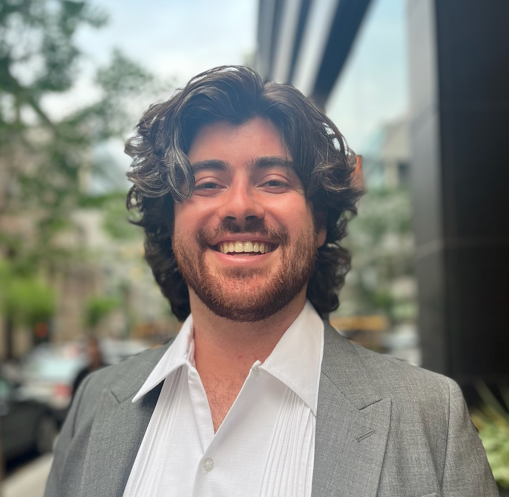

::: {.hero-wrap}
::: {.hero-photo}
{fig-alt="Portrait of Brendon McGuinness"}
:::

::: {.hero-copy}
# Brendon McGuinness

**Postdoctoral Associate**  
Department of Biology · New York University

I am a quantitative ecologist studying how processes from cells to ecosystems shape ecological communities and biodiversity. I focus on how rapid trait change and environmental conditions influence species coexistence and community assembly.

I am currently a postdoctoral associate in the [Pascual Lab](https://wp.nyu.edu/mercedespascual/) at New York University, where I develop computational models of host–pathogen eco-evolutionary dynamics. During my PhD at McGill University, I was advised by [Frédéric Guichard](https://guichardlab.weebly.com/) and [Steph Weber](https://weberlab.ca/), and studied how phenotypic plasticity and metabolic constraints shape community assembly and coexistence in microbial communities.

[Google Scholar](https://scholar.google.ca/citations?user=l_Ux4DEAAAAJ&hl=en&oi=sra){.profile-link} · [GitHub](https://github.com/brendonmcguinness){.profile-link} · [ORCID](https://orcid.org/0009-0001-5629-3004){.profile-link} · [Email](mailto:bm4224@nyu.edu){.profile-link}
:::
:::
