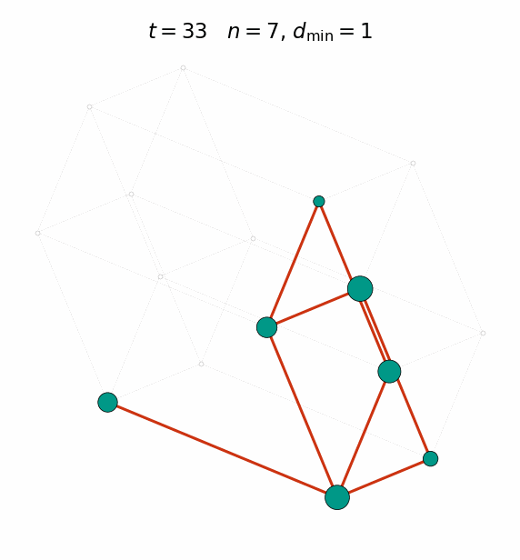
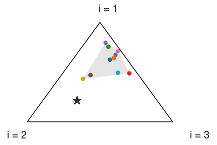
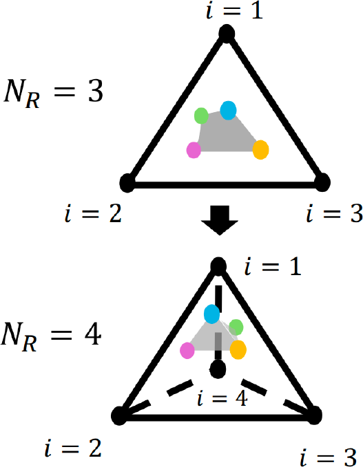
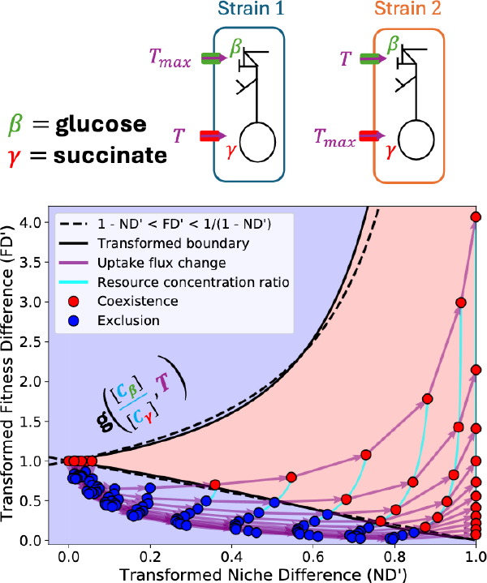
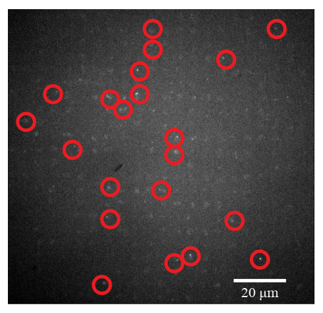

I study how ecological interactions emerge from trait-environment matching, and how those interactions shape coexistence, community assembly, and biodiversity. My work combines mathematical models, computation, microbial experiments, and (in the past) some quantitative imaging.

## Eco-evolutionary dynamics

:::: {.columns .research-feature}
::: {.column width="68%"}

As a postdoctoral associate in the Pascual Lab at New York University, I study how ecological competition and rapid evolution contribute to strain structure and diversity in host–pathogen systems. Pathogen strains compete indirectly through cross-immunity: infection with one strain can protect hosts against similar strains, reducing the hosts available to them and giving more antigenically novel strains an advantage. This resembles consumer–resource competition, except that the resource landscape is continually altered by immune memory.

I use mathematical and computational models to examine how mutation and recombination generate new combinations—and numbers—of antigenic traits. I ask how competition organizes strains across this discrete trait space, when new traits create ecological opportunities, and how transmission or interventions alter pathogen diversity. This work is motivated by the hyperdiverse var genes of Plasmodium falciparum, which enable malaria parasites to vary the proteins displayed on infected red blood cells and evade host immunity.

:::
::: {.column width="32%" .research-figure}

{.research-gif fig-alt="Animation of phenotype assembly in the host–pathogen model"}

::: {.research-caption}
Assembly of phenotypes in a host–pathogen model with cross-immunity and mutation.
:::

:::
::::

## How resource-use plasticity and trait-space geometry affect community structure and diversity

:::: {.columns .research-feature .resource-study-row}
::: {.column width="68%"}

My PhD work focused on how rapid, plastic changes in traits affect ecological communities. Using consumer–resource models inspired by diauxic shifts, in which microorganisms switch between carbon sources, I studied feedbacks between species abundances and their resource-use traits. I found that the rate of plasticity controls how long transient competitive differences persist during community assembly. These transient differences can leave lasting effects on relative abundances after species converge toward ecological equivalence via emergent neutrality. This shows that niche-based sorting and ecological equivalence are not competing explanations: they can describe different stages of the same feedback-driven process, allowing neutral-like dynamics to coexist with strong relationships between traits and abundance.

:::
::: {.column width="32%" .research-figure}

{.research-gif fig-alt="Animation of resource-use plasticity and abundance dynamics in a three-species community"}

::: {.research-caption}
Plastic shifts in resource-use traits during community assembly.
:::

:::
::::

:::: {.columns .research-feature .resource-study-row .resource-study-row-second}
::: {.column width="68%"}

Building on this framework, I asked how these feedbacks change as the number of resources—the dimensionality of the environment—increases. Classical niche theory predicts that more resources should support more species, yet microbial communities show positive, flat, and even negative resource–diversity relationships. I found that higher-dimensional environments can reduce variation among resource-use traits and intensify transient ecological sorting, while faster plasticity shortens these transients and promotes ecological equivalence. The balance among environmental dimensionality, resource-use trade-offs, and plasticity explains why diversity may increase, level off, or decline as resources are added, providing a common framework for understanding these contrasting patterns.

:::
::: {.column width="32%" .research-figure}

{.research-diagram .resource-dimension fig-alt="Illustration of trait space expanding from three to four resource-use dimensions"}

::: {.research-caption}
Expanding resource-use trait space as resources are added.
:::

:::
::::

::: {.pub-item}
**Resource-use plasticity governs the causal relationship between traits and community structure in model microbial communities**  
*Proceedings of the National Academy of Sciences* · 2025
:::

::: {.pub-item}
**Trait-space geometry and plasticity shape resource-diversity relationships in microbial communities**  
*Ecology Letters* · in revision
:::

## Coexistence theory from genome-scale models to experiments

:::: {.columns .research-feature}
::: {.column width="64%"}

To connect community-level theory to processes inside cells, I integrated genome-scale metabolic models and dynamic flux balance analysis with Modern Coexistence Theory, which explains coexistence through the balance between niche and fitness differences. I found that these differences cannot change independently because both arise from the same resource-uptake traits and are constrained by intracellular metabolism. As traits or resource conditions change, communities may pass through exclusion before developing enough niche separation to coexist, with greater differences in resource quality requiring greater ecological separation. I tested these predictions using *E. coli* strains with targeted carbon-transporter deletions in microcosm experiments and showed that manipulating either consumer traits or the balance of supplied resources can produce stable coexistence. This work connects cellular metabolism to community-level biodiversity and provides a framework for predicting and engineering microbial communities.

:::
::: {.column width="36%" .research-figure}

{.research-diagram fig-alt="Conceptual diagram connecting carbon uptake traits to niche and fitness differences and coexistence"}

::: {.research-caption}
Interdependence of niche and fitness differences due to metabolic constraints on resource uptake traits.
:::

:::
::::

::: {.pub-item}
**A winding road to coexistence: Interdependence of niche and fitness differences in *E. coli* with targeted resource uptake gene deletions**  
bioRxiv · 2026
:::

## Using image analysis to study biology across scales

:::: {.columns .research-feature}
::: {.column width="64%"}

During various undergraduate research projects as well as PhD rotation projects, I used quantitative microscopy and computational image analysis to answer biological questions across different levels of organization. I developed tools for analyzing single-molecule microscopy data to quantify interactions in supercoiled DNA. I also applied machine-learning methods to FlowCam images to identify phytoplankton species and track changes in community composition across mesocosms connected by directional flow to form experimental metaecosystems.

:::
::: {.column width="36%" .research-figure}

{.research-photo fig-alt="Microscopy image with computationally detected particles outlined in red"}

::: {.research-caption}
Computational detection of DNA-binding events between an oligonucleotide and a supercoiled plasmid.
:::

:::
::::

::: {.pub-item}
**Single-molecule visualization of the effects of ionic strength and crowding on structure-mediated interactions in supercoiled DNA molecules**  
*Nucleic Acids Research* · 2019
:::

::: {.pub-item}
**Connectivity mediates the spatial ecological impacts of a glyphosate-based herbicide in experimental metaecosystems**  
*Oecologia* · 2024
:::
